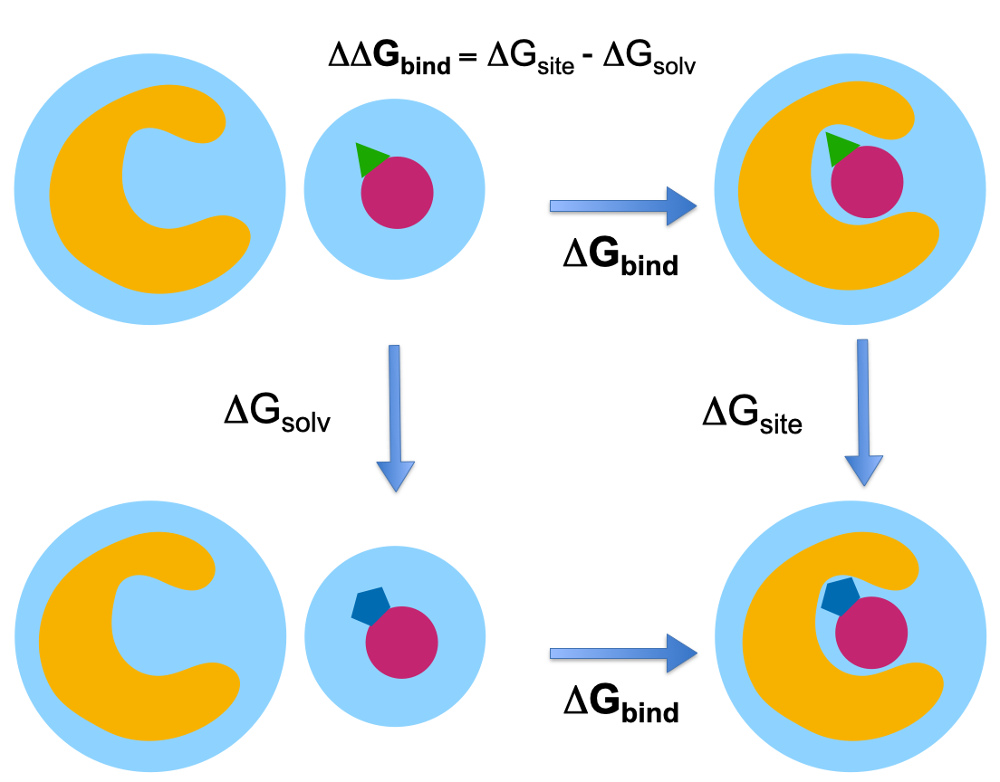
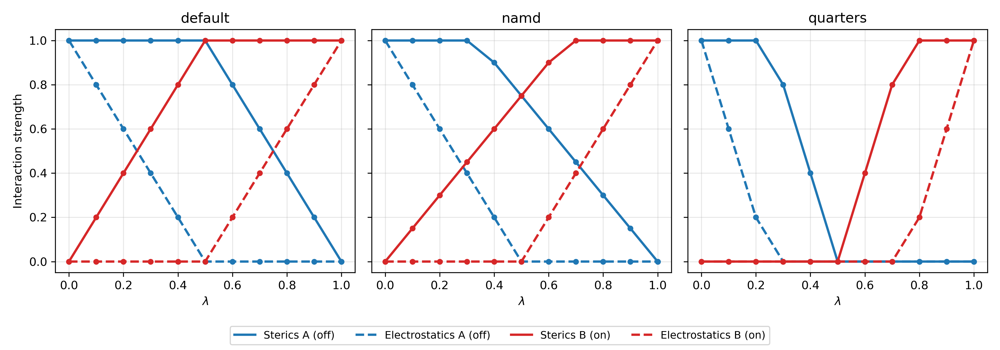
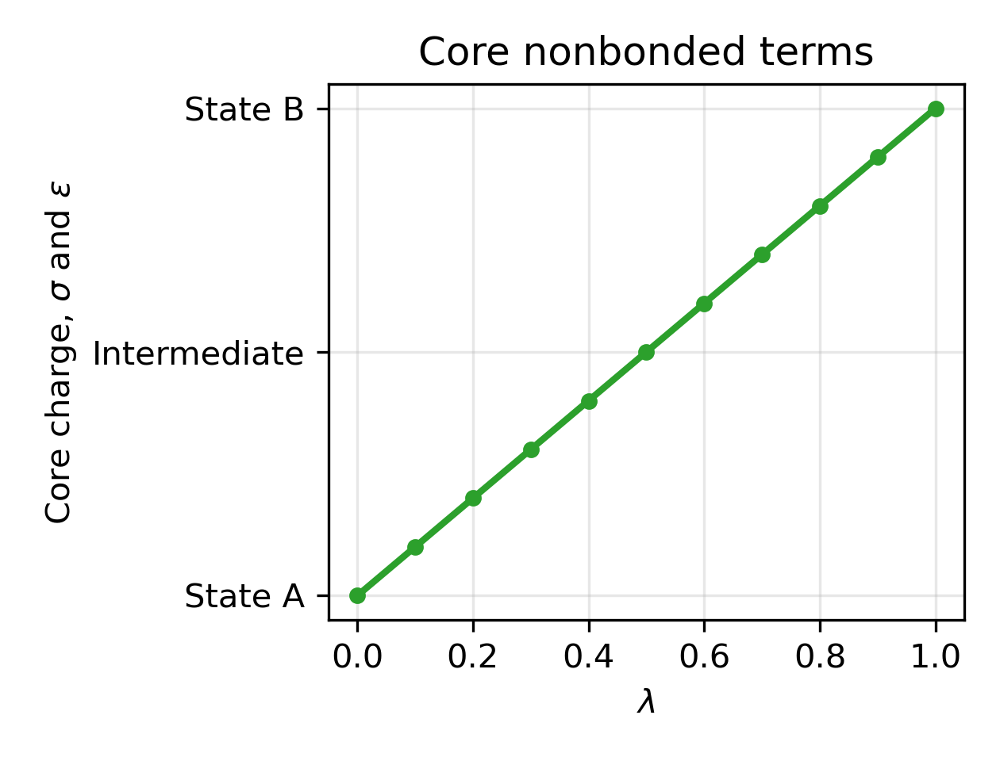

.. _userguide_relative_hybrid_topology_protocol:

Relative Hybrid Topology Protocol
=================================

Overview
--------

The relative free energy calculation approach calculates the difference in 
free energy between two similar ligands. Depending on the :class:`.ChemicalSystem` 
provided, the protocol either calculates the relative binding free energy 
(RBFE), or the relative hydration free energy (RHFE).
Further information on constructing chemical systems to define thermodynamic cycles,
see :ref:`userguide_chemicalsystems_and_components`

In a thermodynamic 
cycle, one ligand is converted into the other ligand by alchemically 
transforming the atoms that vary between the two ligands. The 
transformation is carried out in both environments, meaning both in the 
solvent (ΔG\ :sub:`solv`\) and in the binding site (ΔG\ :sub:`site`\) for RBFE calculations 
and in the solvent (ΔG\ :sub:`solv`\) and vacuum (ΔG\ :sub:`vacuum`\) for RHFE calculations.

.. _label: Thermodynamic cycle for the relative binding free energy protocol

   Thermodynamic cycle for the relative binding free energy protocol.
   
Scientific Details
------------------

This :class:`.RelativeHybridTopologyProtocol` is based off the `Perses implementation <https://perses.readthedocs.io/en/latest/>`_.

The Hybrid Topology approach
~~~~~~~~~~~~~~~~~~~~~~~~~~~~

The :class:`.RelativeHybridTopologyProtocol` uses a hybrid topology approach to represent the two
ligands, meaning that a single set of coordinates is used to represent the
common core of the two ligands while the atoms that differ between the two
ligands are represented separately. An atom map defines which atoms belong
to the core (mapped atoms) and which atoms are unique and represented
separately (see :ref:`Creating atom mappings <Creating Atom Mappings>`). During the alchemical transformation, mapped atoms are interpolated
from their type in the ligand at state A to the type in the other ligand at state B, while unique atoms
atoms (commonly known as dummy atoms) are switched, inserted or uncoupled, depending on which ligand they belong to. By default all nonbonded interactions between the
dummy region and the core region are removed to avoid coupling their motion.

.. note:: In this hybrid topology approach, all bonded interactions between the dummy region and the core region are kept. 
          As pointed out by Fleck et al. [1]_, this can lead to systematic errors if the contribution of the dummy group does not cancel out
          in the thermodynamic cycle (no separability of the partition function). We are currently working on fixing this issue.

The lambda schedule
~~~~~~~~~~~~~~~~~~~

The protocol interpolates molecular interactions between the initial and final state of the perturbation using a discrete set of lambda windows. A function describes how the different lambda components (bonded and nonbonded terms) are interpolated.
Only parameters that differ between state A (``lambda=0``) and state B (``lambda=1``) are interpolated. 
In the default lambda function in the :class:`.RelativeHybridTopologyProtocol`, first the electrostatic interactions of state A are turned off while simultaneously turning on the steric interactions of state B. Then, the steric interactions of state A are turned off while simultaneously turning on the electrostatic interactions of state B. Bonded interactions are interpolated linearly between ``lambda=0`` and ``lambda=1``. The ``lambda_settings`` ``lambda_functions`` and ``lambda_windows`` define the alchemical pathway.
A soft-core potential is applied to the Lennard-Jones potential to avoid instablilites in intermediate lambda windows.
Both the soft-core potential functions from Beutler et al. [2]_ and from Gapsys et al. [3]_ are available and can be specified in the ``alchemical_settings.softcore_LJ`` settings
(default: ``gapsys``).

Choosing a lambda function
""""""""""""""""""""""""""

The ``lambda_settings.lambda_functions`` setting selects how the nonbonded interactions of the unique (dummy) atoms
are switched off in state A and on in state B as ``lambda`` goes from 0 to 1. Mapped (core) atoms and bonded terms are always
interpolated linearly. The available options differ only in *when* the electrostatic and steric (Lennard-Jones) terms are changed:

.. list-table::
   :header-rows: 1
   :widths: 15 20 20 45

   * - Option
     - State A removed
     - State B inserted
     - Description
   * - ``default``
     - Electrostatics: 0.0–0.5; sterics: 0.5–1.0
     - Sterics: 0.0–0.5; electrostatics: 0.5–1.0
     - Two stages. Electrostatics of A are turned off while the sterics of B are turned on, then the sterics of A
       are turned off while the electrostatics of B are turned on. Charges are never present on atoms with
       incompletely-formed sterics.
   * - ``namd``
     - Electrostatics: 0.0–0.5; sterics: 0.33–1.0
     - Sterics: 0.0–0.67; electrostatics: 0.5–1.0
     - Similar to ``default`` but the steric changes are spread over a wider range, so sterics and electrostatics
       are changed simultaneously for part of the path (following Jiang, Chipot and Roux [5]_).
   * - ``quarters``
     - Electrostatics: 0.0–0.25; sterics: 0.25–0.5
     - Sterics: 0.5–0.75; electrostatics: 0.75–1.0
     - Four sequential stages, with only one interaction type being changed at a time.

   Strength of the electrostatic (dashed) and steric (solid) interactions of the unique atoms of state A (blue)
   and state B (red) as a function of ``lambda``, for each of the available ``lambda_functions``.
   The points mark the ``lambda`` values of the default 11 window schedule.

For the core (mapped) atoms, all lambda functions interpolate the charge, :math:`\sigma` and :math:`\epsilon`
linearly between their state A and state B values, so the choice of ``lambda_functions`` does not affect them.

   Interpolation of the nonbonded parameters of a core atom (charge, :math:`\sigma` and :math:`\epsilon`) from their
   state A value to their state B value. The points mark the ``lambda`` values of the default 11 window schedule.

.. note:: We recommend the ``default`` option as it has been extensively tested and validated in
         benchmarks of the protocol, so its performance is best characterised. ``namd`` and ``quarters`` are provided for
         users who want to explore alternative alchemical pathways, but they have not been benchmarked to the same extent.
         If you do change the function, it is good practice to check the overlap between neighbouring windows
         (see :ref:`Energetic and replica exchange analysis <guide/protocols/relativehybridtopology:Energetic and replica exchange analysis>`) and, if needed, increase ``lambda_windows``.

The choice of lambda function can be configured via the protocol settings, for example:

.. code-block:: python

   settings = RelativeHybridTopologyProtocol.default_settings()
   settings.lambda_settings.lambda_functions = "namd"

Simulation overview
~~~~~~~~~~~~~~~~~~~

The :class:`.ProtocolDAG` of the :class:`.RelativeHybridTopologyProtocol` contains the :class:`.ProtocolUnit`\ s from one leg of the thermodynamic
cycle. 
This means that each :class:`.ProtocolDAG` only runs a single leg of a thermodynamic cycle and therefore two Protocol instances need to be run to get the overall relative free energy difference, ΔΔG. 
If multiple ``protocol_repeats`` are run (default: ``protocol_repeats=3``), the :class:`.ProtocolDAG` contains multiple :class:`.ProtocolUnit`\ s of both vacuum and solvent transformations.

Simulation Steps
""""""""""""""""

Each :class:`.ProtocolUnit` carries out the following steps:

1. Parameterize the system using `OpenMMForceFields <https://github.com/openmm/openmmforcefields>`_ and `Open Force Field <https://github.com/openforcefield/openff-forcefields>`_.
2. Create an alchemical system (hybrid topology).
3. Minimize the alchemical system.
4. Equilibrate and production simulate the alchemical system using the chosen multistate sampling method (under NPT conditions if solvent is present).

.. note::
   **Equilibration method:**
   The current implementation uses a simple equilibration protocol **without any positional restraints** or **temperature annealing**.
   The system is equilibrated directly under the target thermodynamic conditions, therefore the input structures should be stable under these conditions.

5. Analyze results for the transformation (for a single leg in the thermodynamic cycle).

Note: three different types of multistate sampling (i.e. replica swapping between lambda states) methods can be chosen; HREX, SAMS, and independent (no lambda swaps attempted). By default the HREX approach is selected, this can be altered using ``simulation_settings.sampler_method`` (default: ``repex``).

Simulation details
""""""""""""""""""

Here are some details of how the simulation is carried out which are not detailed in the :class:`.RelativeHybridTopologySettings`:

* The protocol applies a `LangevinMiddleIntegrator <https://openmmtools.readthedocs.io/en/latest/api/generated/openmmtools.mcmc.LangevinDynamicsMove.html>`_ which uses Langevin dynamics, with the LFMiddle discretization [4]_.
* A MonteCarloBarostat is used in the NPT ensemble to maintain constant pressure.

Getting the free energy estimate
~~~~~~~~~~~~~~~~~~~~~~~~~~~~~~~~

The free energy differences are obtained from simulation data using the `MBAR estimator <https://www.alchemistry.org/wiki/Multistate_Bennett_Acceptance_Ratio>`_ (multistate Bennett acceptance ratio estimator)
as implemented in the `PyMBAR package <https://pymbar.readthedocs.io/en/master/mbar.html>`_.
In addition to the MBAR estimates of the two legs of the thermodynamic cycle and the overall relative binding free energy difference,
the protocol also returns some metrics to help assess convergence of the results.
For how to interpret these analyses, see :ref:`userguide_simulation_health`.

.. note:: The MBAR uncertainty of each individual transformation is estimated using bootstrapping for 1000 iterations,
          this leads to larger errors compared to the previous error estimate method. The only exception are
          the forward and reverse convergence plots which use the MBAR analytical error.

Analysis
~~~~~~~~

After each simulation repeat, the protocol automatically analyses the
energetics of the sampled λ states (MBAR overlap, replica exchange and
forward/reverse convergence) and the structural changes in each state. For
how to interpret these analyses and what to do when a check raises
concerns, see :ref:`userguide_simulation_health`.

The structural analysis differs between the two legs:

* **Complex leg:** ligand RMSD, ligand COM drift and protein 2D RMSD, after
  aligning the trajectory on the protein Cα atoms.
* **Solvent leg:** ligand RMSD only.

The ligand RMSD is computed for the hybrid ligand, including dummy atoms,
and is not symmetry-corrected. The ligand atoms must be included in the
trajectory output (``output_settings.output_indices``, which includes them by
default); otherwise the structural analysis is skipped. Unlike other
protocols, the protein selection and frame stride cannot currently be
configured. The ``structural_analysis.npz`` file also contains a 1D protein
Cα RMSD (``protein_RMSD``), which is not plotted.

.. caution::

Ligand RMSD is calculated for the hybrid ligand, including dummy
atoms. Movement of these atoms can inflate RMSD values even when
the interacting part of the ligand remains in its binding pose.
Inspect the trajectory before interpreting a high RMSD as
evidence of ligand displacement.

The multistate trajectory (``simulation.nc``) and the hybrid topology
(``hybrid_system.pdb``) can be analysed further using `openfe_analysis`_.
.. TODO: Link to the trajectory visualisation cookbook when published.

See Also
--------

**Setting up RFE calculations**

* :ref:`Setting up alchemical networks <alchemical_network_creation>`

**Tutorials**

* :any:`Relative Free Energies with the OpenFE CLI <rbfe_cli_tutorial>`
* :any:`Relative Free Energies with the OpenFE Python API <tutorials/rbfe_python_tutorial.nblink>`

**Cookbooks**

:ref:`Cookbooks <cookbooks>`

**API Documentation**

* :ref:`OpenMM Relative Hybrid Topology Protocol <rfe protocol api>`
* :ref:`OpenMM Protocol Settings <openmm protocol settings api>`

References
----------
* `pymbar <https://pymbar.readthedocs.io/en/stable/>`_
* `perses <https://perses.readthedocs.io/en/latest/>`_
* `OpenMMTools <https://openmmtools.readthedocs.io/en/stable/>`_
* `OpenMM <https://openmm.org/>`_

.. [1] Dummy Atoms in Alchemical Free Energy Calculations, Markus Fleck, Marcus Wieder, and Stefan Boresch, J. Chem. Theory Comput.2021, 17, 4403−4419
.. [2] Avoiding singularities and numerical instabilities in free energy calculations based on molecular simulations, T.C. Beutler, A.E. Mark, R.C. van Schaik, P.R. Greber, and W.F. van Gunsteren, Chem. Phys. Lett., 222 529–539 (1994)
.. [3] New Soft-Core Potential Function for Molecular Dynamics Based Alchemical Free Energy Calculations, V. Gapsys, D. Seeliger, and B.L. de Groot, J. Chem. Theor. Comput., 8 2373-2382 (2012)
.. [4] Unified Efficient Thermostat Scheme for the Canonical Ensemble with Holonomic or Isokinetic Constraints via Molecular Dynamics, Zhijun Zhang, Xinzijian Liu, Kangyu Yan, Mark E. Tuckerman, and Jian Liu, J. Phys. Chem. A 2019, 123, 28, 6056-6079
.. [5] Computing Relative Binding Affinity of Ligands to Receptor: An Effective Hybrid Single-Dual-Topology Free-Energy Perturbation Approach in NAMD, Wei Jiang, Christophe Chipot, and Benoît Roux, J. Chem. Inf. Model. 2019, 59, 9, 3794-3802

.. _openfe_analysis: https://github.com/OpenFreeEnergy/openfe_analysis
