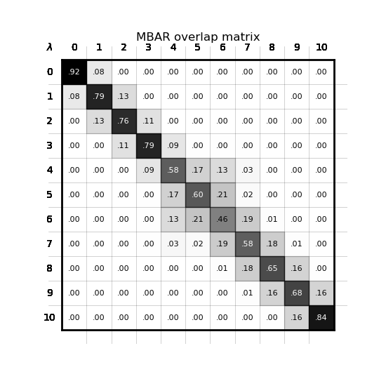
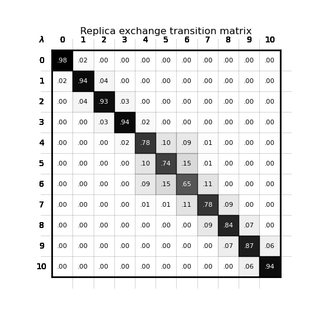
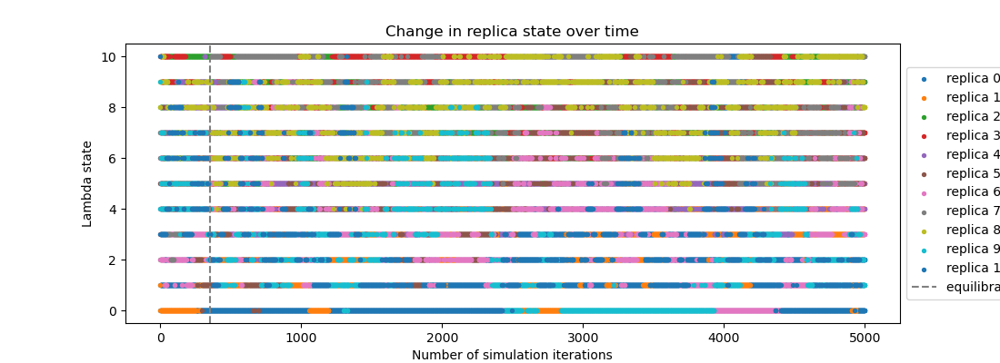
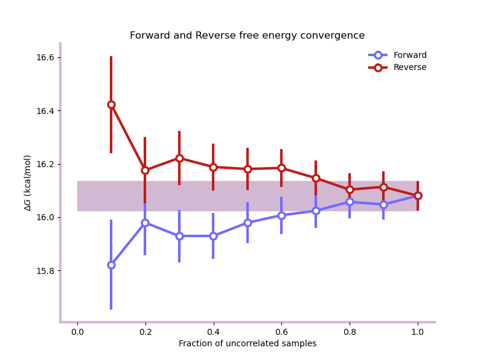
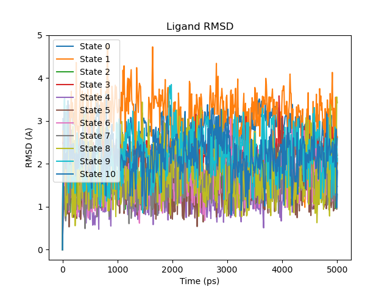
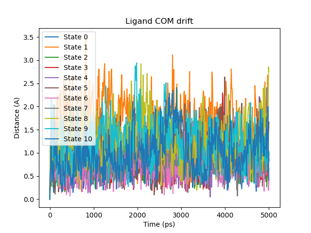
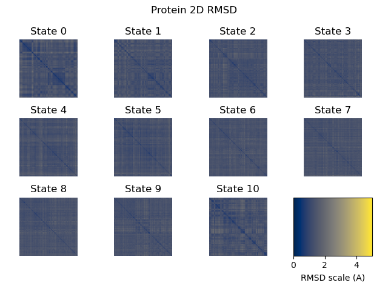

.. _userguide_simulation_health:

Assessing simulation health
===========================

A plausible free energy estimate does not necessarily mean that a simulation
has sampled adequately. Poor overlap between alchemical states, slow replica
mixing, unconverged estimates or structural changes can all make a
result unreliable, without raising an error.

**openfe** automatically performs energetic analysis of its multistate
simulations and, where supported, structural analysis of the saved
trajectories. This page explains how to interpret these diagnostics,
identify sampling problems and decide what to check next.

The guidance applies to :ref:`Relative Hybrid Topology
<userguide_relative_hybrid_topology_protocol>`, :ref:`Separated Topologies
<userguide_septop_protocol>`, :ref:`Absolute Binding <userguide_abfe_protocol>`
and :doc:`Absolute Solvation </guide/protocols/absolutesolvation>`.
Protocol-specific differences are noted below and on each protocol's page.

Where to find the analysis
--------------------------

Diagnostics are generated for each simulation repeat and, where applicable,
each leg of the thermodynamic cycle. Plots are saved in the analysis unit's
directory (``shared_*AnalysisUnit*_attempt_*``); the trajectory and
checkpoint files are in the simulation unit's directory. Directory and
trajectory names depend on the protocol; see :doc:`Execution with Quickrun
</guide/execution/quickrun_execution>` for an example output tree and
:ref:`userguide_individual_results` for loading the results JSON into
Python.

.. list-table:: Available diagnostics
   :header-rows: 1
   :widths: 30 35 35

   * - Diagnostic
     - Plot or file
     - Python results access
   * - Free energy estimates and uncertainty
     - –
     - ``get_estimate()``, ``get_uncertainty()``,
       ``get_individual_estimates()``
   * - MBAR overlap
     - ``mbar_overlap_matrix.png``
     - ``get_overlap_matrices()``
   * - Replica exchange
     - ``replica_exchange_matrix.png``
     - ``get_replica_transition_statistics()``
   * - Replica state mixing
     - ``replica_state_timeseries.png``
     - ``get_replica_states()`` :sup:`*`
   * - Forward/reverse convergence
     - ``forward_reverse_convergence.png``
     - ``get_forward_and_reverse_energy_analysis()``
   * - Equilibration and uncorrelated samples
     - –
     - ``equilibration_iterations()``, ``production_iterations()``
   * - Structural analysis
     - ``ligand_RMSD.png``, ``ligand_COM_drift.png``,
       ``protein_2D_RMSD.png``, ``structural_analysis.npz``
     - ``numpy.load()`` for the ``.npz`` file

:sup:`*` Reads the trajectory and checkpoint files, which must still be at
the paths recorded in the results.

Replica exchange diagnostics require a replica exchange sampler, and the structural
plots available depend on the system and protocol (see :ref:`health_structure`).

Quick health checklist
----------------------

Inspect **all repeats and all relevant thermodynamic legs**. Each check links
to guidance below.

#. **Repeats:** Do the individual repeat estimates agree? (:ref:`details <health_repeats>`)
#. **MBAR overlap:** Are the elements next to the diagonal about 0.03 or
   higher, with no gaps? (:ref:`details <health_overlap>`)
#. **Replica mixing:** Does each replica travel across the full range of
   λ states? Replica exchange only. (:ref:`details <health_exchange>`)
#. **Convergence:** Do the forward and reverse estimates flatten and agree
   before all data are included? (:ref:`details <health_convergence>`)
#. **Structure:** Are the ligand binding poses and protein
   conformations consistent with the expected behaviour,
   and do any restraints remain well defined?
   (:ref:`details <health_structure>`)

If a check raises concerns, see :ref:`health_next_steps`.

.. _health_repeats:

Uncertainty and repeats
-----------------------

Three uncertainties are reported, and they measure different things:

* **Per-repeat MBAR uncertainty** (``unit_estimate_error``): statistical
  uncertainty from the samples within one repeat, estimated by bootstrapping.
* **Between-repeat uncertainty** (``get_uncertainty()``): the sample standard
  deviation of the repeat estimates.
* **Forward/reverse error bars**: analytical MBAR errors for subsets of the
  data (see :ref:`health_convergence`).

A small MBAR uncertainty can coexist with large differences between repeats
if they sample different conformations.

The combined result can hide a single problematic repeat. For example,
repeats of −8.1, −8.3 and −10.2 kcal/mol give −8.9 ± 1.2 kcal/mol, which
looks like an ordinary estimate with a large uncertainty. Looking at the
individual estimates (``get_individual_estimates()``) shows that one repeat
behaves differently, and its trajectory is the one to inspect.
For binding free energies, comparing the legs also shows where a problem
lies. Comparing the thermodynamic legs can help localise sampling
problems. If complex-leg repeats disagree while solvent-leg
repeats agree, focus the investigation on the complex system.

Additional repeats help characterise this variability; longer or more effective sampling may be needed to resolve it.

.. _multistate_analysis:

Energetic analysis
------------------

During the simulation, the energy of every sample is evaluated in every λ
state. The energetic diagnostics use these energies to check three things:
whether neighbouring λ states overlap enough for MBAR to connect the end
states (:ref:`health_overlap`), whether replicas move freely between states
(:ref:`health_exchange`), and whether the free energy estimate has stopped
changing as more data are added (:ref:`health_convergence`).

.. _health_overlap:

MBAR overlap matrix
~~~~~~~~~~~~~~~~~~~

Element *(i, j)* is the probability that a sample from λ state *i* is
observed in state *j*. The most important elements are those directly next
to the diagonal, which show the overlap between neighbouring states. As a
rule of thumb, each should be at least 0.03 [1]_. In the plot, this appears
as an unbroken band along the diagonal.

If a neighbouring pair falls below this threshold, the estimate may be
unreliable even if its reported uncertainty is small.
See :ref:`health_next_steps` for how to improve overlap.

.. _health_exchange:

Replica exchange and mixing
~~~~~~~~~~~~~~~~~~~~~~~~~~~

These diagnostics apply to simulations using a replica exchange sampler,
where replicas periodically swap λ states. Good mixing means every replica
travels across the full range of λ states.

The **replica exchange matrix** shows the probability that a replica in
state *i* moves to state *j*. As with the overlap matrix, check the elements
next to the diagonal: a near-zero element splits the matrix into blocks that
replicas cannot cross between.

The **replica state timeseries** shows which state each replica occupies
over time. Each replica should move across the full range, ideally between
both end states several times. Replicas confined to a subset of states
indicate a barrier, often where the overlap matrix has a gap.

.. _health_convergence:

Convergence and equilibration
~~~~~~~~~~~~~~~~~~~~~~~~~~~~~

The **forward and reverse analysis** recalculates the free energy from
increasing fractions of the data, taken from the start and from the end of
the simulation. Both curves should flatten and agree within error before
all data are included [1]_. Continued drift indicates that more sampling is
needed. The error bars are analytical MBAR errors.

The analysis also identifies an initial equilibration period
(``equilibration_iterations``) and estimates the number of
effectively uncorrelated production samples
(``production_iterations``). If many iterations are discarded
or few uncorrelated samples remain, inspect the trajectory
for slow equilibration or insufficient sampling.

.. _health_structure:

Structural analysis
-------------------

For systems containing a protein, trajectories are first aligned
on the protein. Ligand RMSD and centre-of-mass drift are measured
relative to the first production frame of each λ state, while
protein 2D RMSD compares all analysed frames.

These analyses do not capture structural changes during
equilibration. Structural analysis requires the ligand atoms
to be saved in the trajectory; otherwise it is skipped and a
``structural_analysis_error`` entry is recorded.
Results are saved in ``structural_analysis.npz``.

.. _health_protocol_differences:

.. list-table:: Structural metrics by protocol and leg
   :header-rows: 1
   :widths: 28 14 22 18 18

   * - Protocol
     - Leg
     - Ligand RMSD
     - COM drift
     - Protein 2D RMSD
   * - Relative Hybrid Topology
     - complex
     - ✓ :sup:`a`
     - ✓
     - ✓
   * -
     - solvent
     - ✓ :sup:`a`
     - –
     - –
   * - Separated Topologies
     - complex
     - ✓ :sup:`b,c`
     - ✓ :sup:`c`
     - ✓
   * -
     - solvent
     - ✓ :sup:`b,c`
     - –
     - –
   * - Absolute Binding
     - complex
     - ✓ :sup:`b`
     - ✓
     - ✓
   * -
     - solvent
     - ✓ :sup:`b`
     - –
     - –
   * - Absolute Solvation
     - solvent
     - ✓ :sup:`b`
     - –
     - –
   * -
     - vacuum
     - –
     - –
     - –

| :sup:`a` Computed for the hybrid ligand, including dummy atoms, which can
  inflate the RMSD without a change in the interacting pose. Not
  symmetry-corrected.
| :sup:`b` Symmetry-corrected, so equivalent atom orderings (e.g. a flipping
  phenyl ring) are not counted as changes.
| :sup:`c` Computed separately for both ligands.

**Ligand RMSD** detects changes in the ligand's position, orientation and
conformation.

**Ligand centre-of-mass (COM) drift** measures only translation, so it shows
whether the ligand is leaving the binding site but not whether it rotates.

In **fully interacting bound states**, a ligand RMSD or COM drift that keeps
increasing beyond a few ångströms usually indicates a change in binding mode
or loss of the pose. Larger movements are expected in weakly interacting or
decoupled states.

**Protein 2D RMSD** compares every pair of analysed frames.
Dark blocks indicate similar conformations, while brighter
regions indicate larger structural differences.

For Separated Topologies and Absolute Binding, also check that the Boresch
restraint geometry stays well defined during the simulation (see
:ref:`further trajectory analysis <health_trajectory_analysis>`).

.. _health_trajectory_analysis:

.. rubric:: Further trajectory analysis

Inspect trajectories for changes in binding modes, ring flips, pocket waters,
important interactions or unexpected protein rearrangements. The multistate ``simulation.nc`` trajectory and its
topology (set by ``output_settings.output_structure``, e.g. ``hybrid_system.pdb`` for Relative Hybrid Topology)
can be analysed using `openfe_analysis`_. See the `structural analysis tutorial
<https://openfe-analysis.openfree.energy/en/latest/tutorials/structural_analysis.html>`_
and, for Separated Topologies and Absolute Binding, the `Boresch restraint analysis tutorial
<https://openfe-analysis.openfree.energy/en/latest/tutorials/boresch_analysis.html>`_.

.. _health_next_steps:

What to do when a check raises concerns
---------------------------------------

The same symptom can have several causes, so use the energetic and
structural diagnostics together before changing settings.

.. list-table:: Common warning signs and possible next steps
   :header-rows: 1
   :widths: 26 32 42

   * - Observation
     - What it may indicate
     - What to try
   * - MBAR overlap matrix: elements next to the diagonal below 0.03
     - Large changes between neighbouring λ states
     - Increase the number of λ windows or adjust the λ schedule to improve overlap.
   * - Replica state timeseries: replicas stay within a subset of λ states,
       or the replica exchange matrix shows isolated blocks
     - A gap in overlap, or a slow conformational change
     - If the overlap matrix shows a gap, add λ windows. Otherwise check the
       structural analysis and consider longer production.
   * - Forward and reverse analysis: the estimates only agree at the full
       data set, or the forward estimate is still drifting
     - The system is still relaxing, or sampling is insufficient
     - Check ``equilibration_iterations`` and the structural analysis;
       run longer production.
   * - Repeat estimates differ by more than their MBAR errors
     - Repeats sample different conformations or slow degrees of freedom
     - Compare the structural analysis between repeats. Longer production
       may help; more repeats (``protocol_repeats``) better characterise
       the variability.
   * - Ligand RMSD or COM drift keeps increasing in the fully interacting bound states
     - A change in binding mode, or loss of the pose. Large values are
       expected in weakly interacting or decoupled states.
     - Check the prepared pose against the poses sampled in the
       trajectory. For Absolute Binding and Separated Topologies, also check the restraints.
   * - Charge-changing transformation: large spread between repeats, or
       forward and reverse estimates disagree
     - Slow solvent or ion rearrangements, or insufficient sampling
     - For Relative Hybrid Topology, enable explicit charge correction
       and consider the recommended adaptive settings (22 λ windows,
       22 replicas and 20 ns production per window).

For simulations that fail with an error, see
:doc:`Troubleshooting simulations </guide/troubleshooting>`.

Beyond a single transformation
------------------------------

Some problems only show up across a network. Relative free energies around a
cycle should sum to zero within their uncertainties, and each edge should
agree with the value implied by the rest of the network. Large deviations
point to unreliable edges worth checking with the diagnostics above. These checks need a network with redundant edges
(see :doc:`Generate ligand networks </cookbook/generate_ligand_network>`).
To calculate cycle closure errors, see the `cinnabar cycle closure tutorial
<https://cinnabar.openfree.energy/en/latest/tutorials/cycle-closure.html>`_.

See also
--------

**Results and troubleshooting**

* :ref:`userguide_individual_results`
* :ref:`userguide_result_networks`
* :doc:`Troubleshooting simulations </guide/troubleshooting>`
* :ref:`userguide_preparing_inputs`

**Protocols**

* :ref:`Relative Hybrid Topology <userguide_relative_hybrid_topology_protocol>`
* :ref:`Separated Topologies <userguide_septop_protocol>`
* :ref:`Absolute Binding <userguide_abfe_protocol>`
* :doc:`Absolute Solvation </guide/protocols/absolutesolvation>`

**Further analysis**

* `openfe_analysis`_
* `cinnabar cycle closure tutorial
  <https://cinnabar.openfree.energy/en/latest/tutorials/cycle-closure.html>`_

References
----------

.. [1] Klimovich, P. V., Shirts, M. R. and Mobley, D. L. (2015).
   Guidelines for the analysis of free energy calculations.
   *Journal of Computer-Aided Molecular Design*, 29, 397--411.
   doi: `10.1007/s10822-015-9840-9
   <https://doi.org/10.1007/s10822-015-9840-9>`_.

.. _openfe_analysis: https://openfe-analysis.openfree.energy/en/latest/