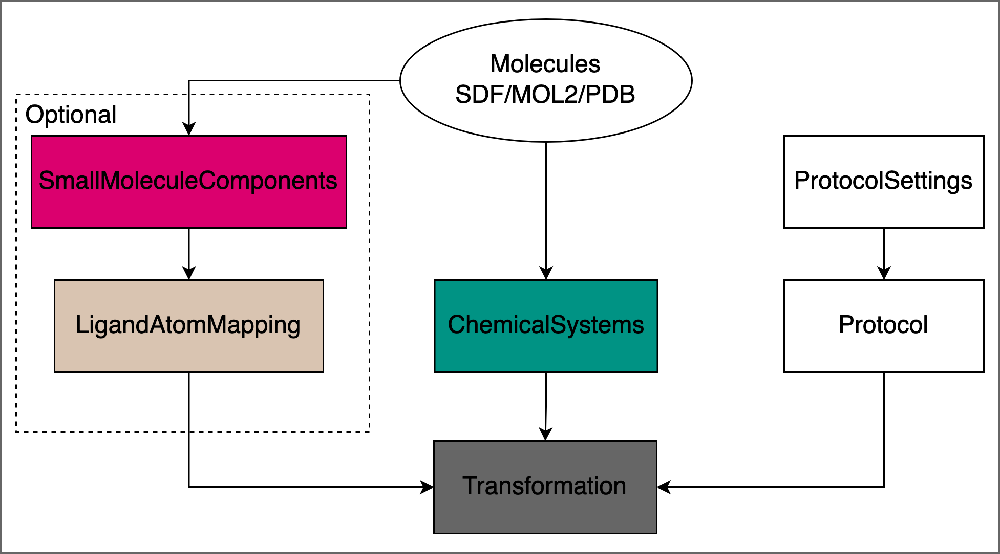
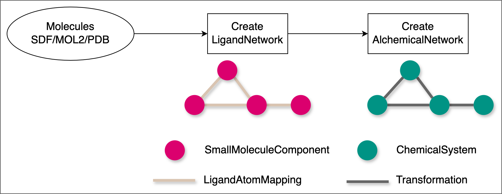

.. _userguide_setup:

Simulation Setup
================

This section provides details on how to set up a free energy calculation or MD simulations.

Setting up a calculation generally involves:

* :ref:`Preparing the input structures <userguide_preparing_inputs>`.
* Loading the structures and creating :class:`.ChemicalSystem` objects.
* Defining the :class:`.Protocol` with specific `ProtocolSettings`.
* Creating :class:`.LigandAtomMapping` objects for relative free energy calculation `Protocols`.

The image below demonstrates how, for relative free energy calculations, you plan a
network of ligand transformations starting from input SDF / MOL2 / PDB files:

The procedure for setting up a simulation depends on the
type of free energy calculation you are running.
More detailed guidance is available in the following sections:

.. toctree::
   :maxdepth: 1

   input_preparation
   chemical_systems_and_thermodynamic_cycles
   creating_atom_mappings_and_scores
   defining_protocols
   creating_ligand_networks
   alchemical_network_model

To set up your alchemical network using the Python interface, but run it using the CLI,
you will need to export the network in the same format used by the CLI.
See :ref:`dumping transformations <dumping_transformations>` for more details.

.. admonition:: How-to guides

   **Setup**

   * :doc:`/how_to_guides/loading_molecules`
   * :doc:`/how_to_guides/user_charges`
   * :doc:`/how_to_guides/bespoke_parameters`

   **Planning: Ligand networks**

   * :doc:`/how_to_guides/generate_ligand_network`
   * :doc:`/how_to_guides/hand_write_ligand_network`
   * :doc:`/how_to_guides/network_from_orion_fepp`
   * :doc:`/how_to_guides/ligandnetwork_vis`
   * :doc:`/how_to_guides/repairing_broken_networks`

   **Planning: Protocols and alchemical networks**

   * :doc:`/how_to_guides/choose_protocol`
   * :doc:`/how_to_guides/rfe_alchemical_planners`
   * :doc:`/how_to_guides/create_alchemical_network`

.. TODO: add the new Setup and Planning how-tos to this box as they are added.
